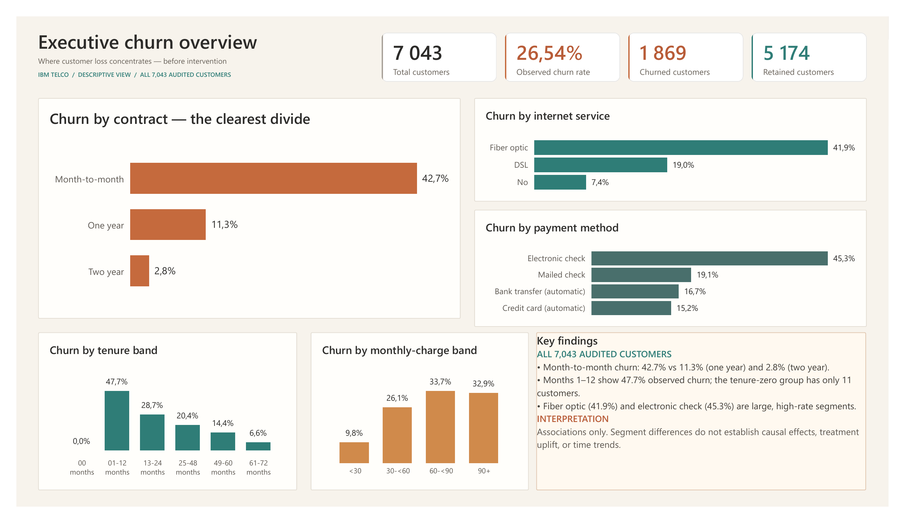
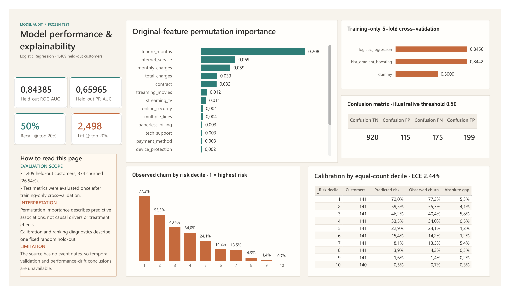
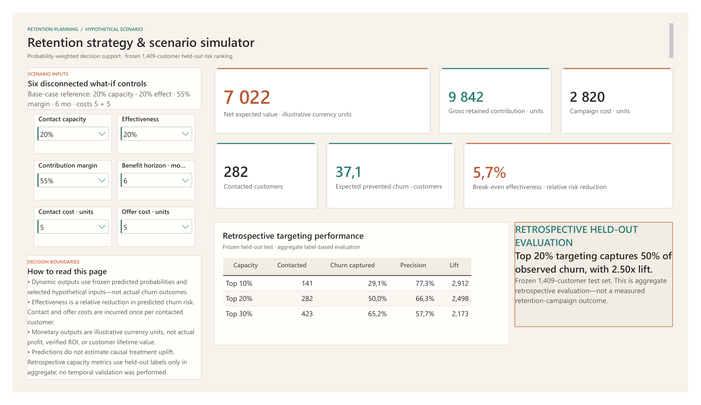

# Telecom Customer Churn Prediction & Retention Strategy

An end-to-end data analytics and machine-learning portfolio project built on the audited IBM Telco Customer Churn dataset. The project connects reproducible customer-level analysis to model evaluation and an executive Power BI decision-support report:

**SQL / DuckDB → Python ML → model evaluation and reliability audit → Power BI → hypothetical retention scenarios**



## Project at a glance

| Verified result | Value | Evaluation scope |
|---|---:|---|
| Audited customers | 7,043 | Full descriptive population |
| Observed churn rate | 26.54% | Full descriptive population |
| Held-out ROC-AUC | 0.84385 | Frozen 1,409-customer test set |
| Held-out PR-AUC | 0.65965 | Frozen 1,409-customer test set |
| Recall at top 20% | 50% | Retrospective held-out targeting evaluation |

The dashboard deliberately separates descriptive results for all 7,043 customers from model diagnostics on the frozen 1,409-customer held-out set. Retention-value outputs are scenario estimates based on configurable assumptions—not measured campaign impact, verified retention uplift, realized profit, or actual ROI.

## Dashboard Gallery

The complete report is available as a [three-page PDF](docs/TelecomChurnDashboard.pdf). The source PBIP/PBIR/TMDL project is maintained under [`powerbi/`](powerbi/).

### 1. Executive Churn Overview

Descriptive KPIs and segment-level churn patterns across the full audited customer population.


### 2. Model Performance & Explainability

Held-out performance, training-only cross-validation, original-feature permutation importance, risk deciles, calibration, and confusion-matrix diagnostics.



### 3. Retention Strategy & Scenario Simulator

Six disconnected what-if controls combine frozen predicted probabilities with explicitly hypothetical cost, margin, horizon, capacity, and effectiveness assumptions.



## Analytical workflow

1. **Data audit and SQL preparation** — preserve the source CSV, parse numeric fields safely, retain blank `TotalCharges` values as `NULL`, and build a typed customer-level DuckDB table.
2. **Exploratory analysis** — calculate reconciled descriptive statistics, group sizes, churn counts, and segment-level churn rates without causal or unsupported time-based claims.
3. **Predictive modeling** — create a deterministic stratified 80/20 split and compare a dummy baseline, logistic regression, and a tree-based model using training-only cross-validation.
4. **Evaluation and reliability** — evaluate the selected logistic-regression pipeline once on the untouched test set, then audit coefficients, permutation importance, subgroup performance, calibration, and risk deciles without retraining.
5. **Retention prioritization** — evaluate fixed top-risk capacities retrospectively and calculate transparent hypothetical value scenarios from frozen probabilities.
6. **Power BI delivery** — publish the validated analytical exports through a portable semantic model, 49 DAX measures, and a three-page report with 39 native visuals.

## Reproducible setup

From the project root in Windows PowerShell:

```powershell
python -m venv .venv
.\.venv\Scripts\python -m pip install -r requirements.txt
.\.venv\Scripts\python src\prepare_data.py
.\.venv\Scripts\python src\run_eda.py
.\.venv\Scripts\python -m unittest discover -s tests -v
```

Generated outputs are intentionally excluded from Git:

- `data/processed/telco_churn.duckdb`
- `outputs/eda/*.csv`
- `artifacts/phase3a/v1/`
- `artifacts/phase3b/v1/`
- `outputs/powerbi/phase4a/v1/`

The preparation command runs integrity and reconciliation checks before committing database changes. The test suite independently rebuilds the database in a temporary directory and verifies frozen artifacts, scenario calculations, PBIP structure, paths, relationships, measures, and report bindings.

## SQL and DuckDB data layer

The pipeline preserves `data/raw/Telco-Customer-Churn.csv`, loads an all-text copy into DuckDB, and creates a typed customer-level analytical table. Blank or whitespace-only `TotalCharges` values remain SQL `NULL`; no pre-model imputation is applied.

Main analytical objects:

- `raw.telco_churn` — source columns loaded as text.
- `analytics.customers` — one typed row per customer; `customer_id` is retained only as an identifier.
- `analytics.numeric_summary` — descriptive statistics for tenure and charges.
- `analytics.churn_by_segment` — group sizes, churn counts, and churn rates for selected dimensions.
- `analytics.churn_by_tenure_month` — exact-tenure group sizes and churn rates.

Preparation logic is in [`sql/01_prepare.sql`](sql/01_prepare.sql), and named EDA queries are in [`sql/02_eda_queries.sql`](sql/02_eda_queries.sql).

## Modeling and reliability audit

### Train and evaluate the candidate models

```powershell
.\.venv\Scripts\python src\train_models.py
.\.venv\Scripts\python -m unittest discover -s tests -v
```

The modeling pipeline reads the validated DuckDB table without changing it. It creates a deterministic stratified split, fits preprocessing only within training folds, compares three model families using five-fold cross-validation on the training partition, and evaluates the selected model once on the held-out test partition.

Versioned outputs are written to the Git-ignored `artifacts/phase3a/v1/` directory. The command refuses to overwrite an existing artifact version; use a new `--version` value for a later run.

### Audit the frozen selected model

```powershell
.\.venv\Scripts\python src\audit_model.py
.\.venv\Scripts\python -m unittest discover -s tests -v
```

The audit loads the frozen Phase 3A pipeline, split, and predictions. It does not fit, tune, or reselect a model. It calculates original-column permutation importance, extracts logistic-regression coefficients, reports fixed-test subgroup diagnostics, and reconciles calibration and risk deciles. Versioned outputs are written to the Git-ignored `artifacts/phase3b/v1/` directory.

## Retention prioritization and scenario analysis

```powershell
.\.venv\Scripts\python src\retention_scenarios.py
.\.venv\Scripts\python src\validate_powerbi_contract.py
.\.venv\Scripts\python -m unittest discover -s tests -v
```

The retention workflow consumes the frozen held-out predictions without changing the model. It evaluates fixed top-risk contact capacities using actual churn labels only for retrospective aggregate evaluation. The financial scenario model then combines predicted churn probabilities with explicitly hypothetical assumptions for contact capacity, relative risk reduction, contribution margin, benefit horizon, contact cost, and optional offer cost.

Assumptions are stored in [`config/retention_scenarios_v1.json`](config/retention_scenarios_v1.json). Power BI-ready files are written to the Git-ignored `outputs/powerbi/phase4a/v1/` directory. The contract validator independently reconciles scenario, break-even, sensitivity, capacity, targeting, key, grain, and data-type requirements without changing the exports.

## Power BI project

The portable PBIP/PBIR/TMDL project is under [`powerbi/`](powerbi/). Its 1280×720 report contains exactly three approved pages and 39 native visuals:

1. **Executive Churn Overview** — descriptive KPIs and segment-level churn for all 7,043 audited customers.
2. **Model Performance & Explainability** — frozen held-out metrics, training-only model comparison, feature importance, risk deciles, calibration, and confusion-matrix diagnostics.
3. **Retention Strategy & Scenario Simulator** — six disconnected what-if inputs, dynamic scenario measures, and retrospective targeting-capacity results.

The semantic model contains 19 imported analytical tables, six disconnected parameter tables, 49 DAX measures, and five relationships. Dynamic scenario measures use frozen predicted probabilities and selected hypothetical inputs. They do not use actual churn labels to calculate expected value and do not estimate causal treatment uplift.

```powershell
.\.venv\Scripts\python src\validate_pbip_model.py
.\.venv\Scripts\python -m unittest discover -s tests -v
```

The validator checks the three-page/39-visual report contract, table sources, grains, keys, relationships, disconnected tables, 49-measure inventory, neutral `DataRoot` parameter, Microsoft schema declarations, unresolved Power Query changes, personal paths, and publication exclusions. It independently reconciles all nine Phase 4A scenario-capacity outcomes.

Before opening the project on a workstation, generate the ignored Phase 2–4 outputs, open [`powerbi/TelecomChurn.pbip`](powerbi/TelecomChurn.pbip), and set `DataRoot` locally through Power BI Desktop. Before source control or distribution, restore it to `<SET_PROJECT_ROOT>`.

## Documentation

- [Dataset audit and source integrity](docs/data_audit.md)
- [Exploratory data analysis findings](docs/eda_findings.md)
- [Model evaluation](docs/model_evaluation.md)
- [Model explainability and reliability audit](docs/model_explainability_reliability.md)
- [Retention strategy assumptions and formulas](docs/retention_strategy.md)
- [Power BI data contract](docs/powerbi_data_contract.md)
- [Dashboard specification](docs/dashboard_specification.md)
- [Semantic model and Desktop refresh instructions](docs/powerbi_semantic_model.md)
- [Complete dashboard PDF](docs/TelecomChurnDashboard.pdf)

## Interpretation boundaries

- Segment-level churn differences are descriptive associations, not causal effects.
- Model explanations describe the fitted prediction function; they do not identify intervention effects.
- The source data has no event dates, so the evaluation is a fixed random hold-out rather than temporal validation.
- Actual churn labels are used for retrospective evaluation only, never to choose individual customers or calculate dynamic scenario value.
- Scenario effectiveness is an assumed relative reduction in predicted churn risk, not measured treatment uplift.
- Financial outputs are illustrative currency-unit estimates, not verified customer lifetime value, realized profit, or actual ROI.
